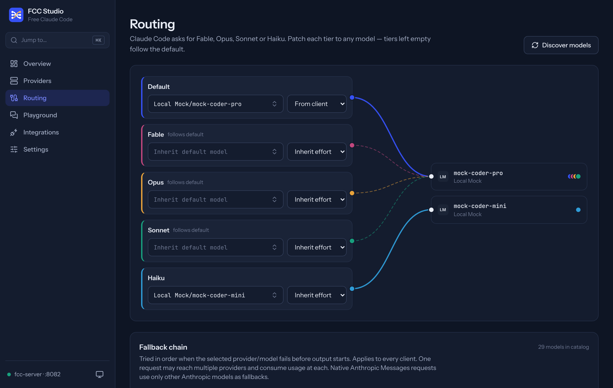

<div align="center">


# FCC Studio

**Eine moderne App für [Free Claude Code](https://github.com/Alishahryar1/free-claude-code):
Claude Code, Codex und 10 weitere Coding-Agents mit jedem Modell-Provider betreiben, kostenlose Tiers inklusive.**

</div>



FCC Studio ist eine installierbare Web-App (PWA). Sie ersetzt die eingebaute Admin-Seite von Free Claude Code (FCC)
durch eine schnelle, durchgehend getypte Oberfläche. Der FCC-Server bleibt unverändert und wird als Submodul
mitgeliefert. Studio spricht ausschließlich mit seiner lokalen Admin-API.

## Funktionen

| Bereich | Was du damit machst |
| --- | --- |
| **Overview** | Live-Signalweg *Agent → fcc-server → Modell*, Provider-Status, Tier-Routing, Startbefehle zum Kopieren |
| **Providers** | Alle 61 Provider durchsuchen und filtern. Mehrere API-Keys pro Provider (Reihenfolge = Fallback-Reihenfolge), Verbindungstest, Status lokaler Server (LM Studio, llama.cpp, Ollama), Account-Login für ChatGPT und GitHub Copilot per Browser oder Device-Code |
| **Custom Provider** | Beliebige OpenAI- oder Anthropic-kompatible Endpunkte anlegen, bearbeiten, testen und entfernen |
| **Routing** | Patch-Bay: Default, Fable, Opus, Sonnet und Haiku auf beliebige Modelle legen, je mit eigenem Reasoning-Effort, dazu eine sortierbare Fallback-Kette |
| **Playground** | Streaming-Chat über `/v1/messages`, genau wie Claude Code. Tier oder direktes Modell wählen, Extended Thinking, Zeit bis zum ersten Token, Tokens pro Sekunde |
| **Integrations** | Claude Desktop, Claude Code für VS Code, VS Code Chat, Codex, JetBrains, DeepSeek Desktop und Antigravity mit einem Klick verbinden oder trennen |
| **Settings** | Server, Messaging (Discord/Telegram), Voice, Web-Tools und Diagnose, mit Änderungsübersicht und automatischem Neustart, wenn nötig |

Dazu: Command Palette (<kbd>⌘K</kbd> / <kbd>Ctrl K</kbd>), Hell- und Dunkelmodus, mobiltauglich, offline-fähige
App-Hülle, Tastaturbedienung.

## Schnellstart

Voraussetzungen: **Node.js 20+** sowie entweder ein installiertes FCC
([Installer](https://github.com/Alishahryar1/free-claude-code#install)) oder [uv](https://docs.astral.sh/uv/)
für das mitgelieferte Server-Submodul.

```bash
git clone --recurse-submodules https://github.com/FreZZyBuilds/free-claude-code-app.git
cd free-claude-code-app
./scripts/start.sh          # Windows: .\scripts\start.ps1
```

Das Skript startet `fcc-server`, falls er noch nicht läuft, baut die App und öffnet
**http://127.0.0.1:5174**. Über *Installieren* in der Adressleiste wird daraus eine eigenständige Desktop-App.

Erste Schritte in der App:

1. **Providers → NVIDIA NIM** (oder OpenRouter): *Add key*, Key einfügen, *Save*.
2. **Routing**: Modelle für die Tiers wählen, *Apply routing*.
3. **Playground**: Nachricht senden und prüfen, ob die Antwort durchkommt.
4. Im Terminal `fcc-claude` (oder `fcc-codex`, `fcc-opencode` …) starten.

## Android-App

`android/` enthält eine native Android-App mit eigenem Server. Auf **Play** tippen, und der Server läuft direkt
auf dem Handy unter `http://127.0.0.1:8082`, auch im Hintergrund (Benachrichtigung mit *Stoppen*). Über
*Studio öffnen* erscheint dieselbe Studio-Oberfläche wie am PC.

- **Server in der App:** Der Original-FCC-Server braucht Python 3.14 mit nativen Bibliotheken und läuft nicht in
  einer Android-App. Die App enthält deshalb einen eigenen Kotlin-Server (`android/core`) mit der Kernfunktion von
  FCC: Claude-Code-Anfragen (Anthropic Messages API) an 56 Provider weiterleiten, mit Streaming, Tool-Calls,
  Thinking, Tier-Routing (Fable/Opus/Sonnet/Haiku), Key-Rotation bei Rate-Limits und Fallback-Kette. Er spricht
  dieselbe Admin-API, deshalb läuft Studio unverändert.
- **Nur am PC:** Account-Logins (ChatGPT, Copilot), Azure, Vertex, Cloudflare sowie die Desktop-Integrationen.
- **Claude Code auf dem Handy:** In [Termux](https://termux.dev) `pkg install nodejs`,
  `npm i -g @anthropic-ai/claude-code`, dann
  `ANTHROPIC_BASE_URL=http://127.0.0.1:8082 ANTHROPIC_AUTH_TOKEN=fcc claude`.
- **Berechtigungen:** Internet, Vordergrund-Dienst (`specialUse`), Wake-Lock, Benachrichtigungen (Android 13+
  fragt beim ersten Play). API-Keys bleiben im privaten App-Speicher und sind von Backups ausgeschlossen.

APK bauen (Node 20+, JDK 17+, Android SDK mit Platform 36):

```bash
cd app && npm ci && npm run build      # Studio-Oberfläche, wird in die APK gepackt
cd ../android && ./gradlew assembleRelease
# → android/app/build/outputs/apk/release/app-release.apk
```

Der Server-Kern läuft zum Testen auch am PC: `./gradlew :core:run --args="../../app/dist"`. Die GitHub Action
`Android APK` baut Debug- und Release-APK als Download. Für eine Play-Store-Signatur die Secrets
`FCC_KEYSTORE_BASE64`, `FCC_KEYSTORE_PASSWORD`, `FCC_KEY_ALIAS` und `FCC_KEY_PASSWORD` setzen.

## Entwicklung

```bash
cd app
npm install
npm run dev            # http://127.0.0.1:5173, Hot Reload, Proxy auf FCC_URL
npm run typecheck
npm test               # Vitest
npm run build && npm run test:e2e   # Playwright gegen einen laufenden fcc-server
```

Läuft FCC auf einem anderen Port: `FCC_URL=http://127.0.0.1:9000 npm run dev`.

### Architektur

```
Browser ──▶ Studio (127.0.0.1:5174)
              ├─ /           statische App (dist/)
              └─ /admin /v1  ──▶ fcc-server (127.0.0.1:8082) ──▶ Provider
```

Die Admin-API von FCC beantwortet nur Anfragen vom eigenen Rechner mit lokalem `Host` und `Origin`. Deshalb
liefert `app/server.mjs` (ohne Abhängigkeiten) die App aus und leitet API-Aufrufe über denselben Ursprung weiter.
Er lauscht nur auf `127.0.0.1`. Gespeicherte Secrets verlassen den Server nie: Der Key-Editor arbeitet mit
Referenzen auf gespeicherte Keys.

```
app/            React 19 · TypeScript · Vite 8 · Tailwind CSS 4 · TanStack Query · React Router 7
  src/lib/      API-Client, Typen, SSE-Streaming, sicherer Markdown-Renderer
  src/pages/    Overview, Providers, Routing, Playground, Integrations, Settings
  server.mjs    Produktionsserver + lokaler Proxy
  e2e/          Playwright-Tests
android/        Android-App: core/ (Kotlin-Server, Ktor) + app/ (Play-Bildschirm, Dienst, WebView)
server/         Free Claude Code (Git-Submodul, unverändert)
scripts/        start.sh / start.ps1
.claude/skills/ Kuratierte Claude-Code-Skills von aitmpl.com
```

## Claude-Code-Skills

`.claude/skills/` enthält 13 ausgewählte Skills von [aitmpl.com](https://www.aitmpl.com/skills), darunter
`frontend-design`, `ui-ux-pro-max`, `react-best-practices`, `fastapi-pro`, `code-reviewer`,
`cc-skill-security-review` und `webapp-testing`. Claude Code lädt sie automatisch, wenn du in diesem Repo
arbeitest. Herkunft und Zweck jedes Skills stehen in [`.claude/skills/README.md`](.claude/skills/README.md).

## Lizenz

AGPL-3.0, wie das Upstream-Projekt. Provider-Logos stammen aus FCC (Lobe Icons, MIT; Quellen in
`app/public/providers/SOURCES.md`). Marken gehören ihren Inhabern. Kein offizielles Produkt von Anthropic.
